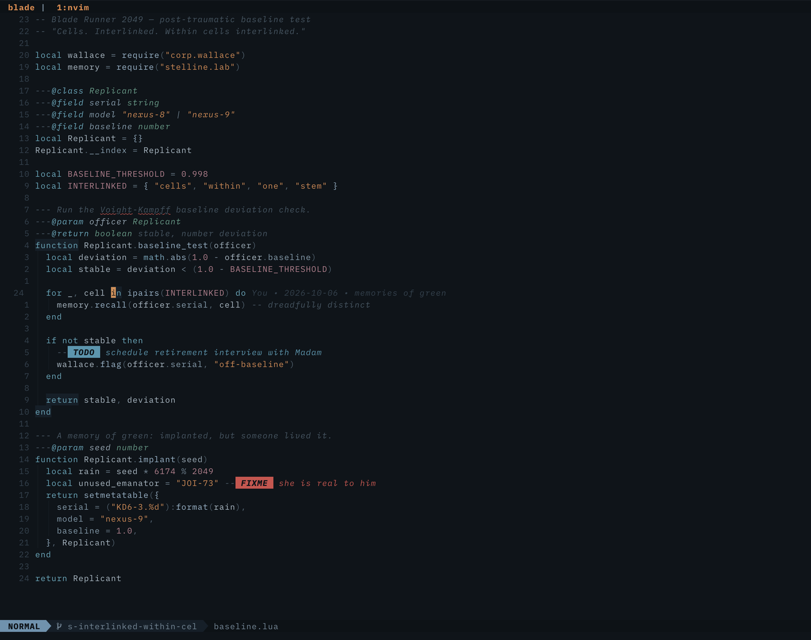
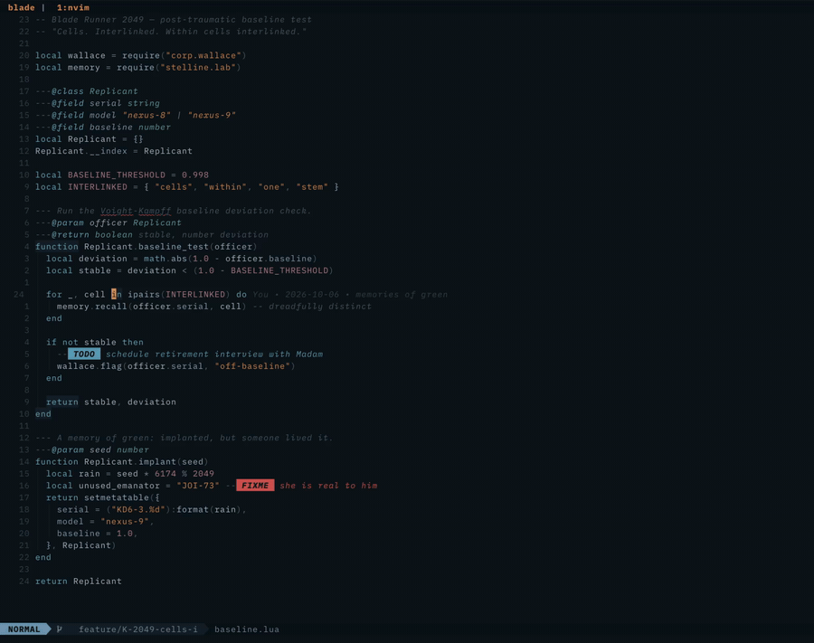

# interlinked.nvim

A melancholic **Blade Runner 2049** colorscheme for Neovim — with ambient,
film-grade effects.

Not the neon-purple cyberpunk cliché. This is Deakins' photography: the cold
blue-grey fog of LA, the irradiated amber of Las Vegas as the single warm
accent, Joi's desaturated hologram cyan, dusty rose, sea-wall green. Every
color is muted; nothing glows unless it has to.



## Features

- **Full palette** for core UI, Treesitter, LSP semantic tokens and
  diagnostics (including virtual lines), plus integrations for telescope,
  neo-tree, nvim-cmp, gitsigns, which-key, noice/notify, dashboard, lazy,
  mason, flash, todo-comments, indent-blankline, illuminate, lspsaga, ufo,
  dap-ui, **neotest, diffview, grug-far, codecompanion, treesitter-context,
  render-markdown, snipe**, vim-matchup, package-info, toggleterm.
- **Neon flicker** — the UI ages like the sets of the film: elements sputter,
  dip and surge at random intervals. Three levels, off by command.
- **`:Interlinked`** — the baseline test as a *live session report*.
- **Marquee** — an infinite scrolling band for long statusline text.
- Lualine theme (auto-discovered), terminal colors, tmux theme and iTerm2
  preset in [`extras/`](extras/).

## The baseline test is a status report

`:Interlinked` types out the film's interrogation — but the answers are your
session, live: git branch and dirty state, workspace diagnostics, attached
LSP clients, last commit, pending updates. The verdict depends on what it
finds: a clean session earns *"Constant K. You can pick up your bonus."* —
errors get *"You're not even close to baseline."*


`:Interlinked poem` plays the original scene instead, slow and dramatic.

## Ambient fx

Every 6–40 seconds (level-dependent) one event fires: the whole frame drowns
in Vegas amber and the fog rolls back in, a scanner sweeps down the gutter,
the statusline browns out, comments fade like unstable memories, keywords
blush rose for a blink, or the grid blacks out and double-taps back on.



```
:InterlinkedFx off | subtle | full | extreme | toggle
:InterlinkedFx now [vegas|wipe|joi|scan|blackout|status|nr|surge|gutter|comment]
```

Deliberately **not strobe-like**: single bursts built from long holds (≤3
cycles spread over ≥1.1s, under the 3-flashes-per-second photosensitivity
guideline), small luminance deltas, long silences between events. Events
that would hit invisible UI (no cursorline, no splits) are skipped.

## Install

With [lazy.nvim](https://github.com/folke/lazy.nvim):

```lua
{
  "daaanny90/interlinked.nvim",
  lazy = false,
  priority = 1000,
}
```

Then:

```vim
:colorscheme interlinked
```

Requires Neovim **0.10+** (`vim.system`, `vim.uv`, `vim.diagnostic.count`).

## Configuration

Defaults shown — call `setup()` only to override:

```lua
require("interlinked").setup({
  transparent = false,
  italic_comments = true,
  bold_keywords = false,
  terminal_colors = true,
  flicker = "extreme", -- "extreme" | "full" | "subtle" | false
})
```

The runtime level chosen with `:InterlinkedFx` wins over the config default
for the rest of the session.

## Marquee (scrolling statusline text)

`require("interlinked.marquee").scroll(text, width)` returns `text` unchanged
while it fits, and a scrolling window over it when it doesn't. A shared
ticker (160ms) forces lualine refreshes only while something actually
scrolls, stops itself 3s after the last long text disappears, and pauses on
`FocusLost` (inside tmux set `set -g focus-events on`).

Lualine example — a branch component that scrolls long ticket names:

```lua
local function branch_marquee()
  local head = vim.b.gitsigns_head
  if not head or head == "" then
    return ""
  end
  local ok, mq = pcall(require, "interlinked.marquee")
  return ok and mq.scroll(head, 24) or head
end

-- in your lualine sections:
lualine_b = { { branch_marquee, icon = { "" } } }
```

## Extras

- `extras/interlinked.tmux` — matching tmux status bar / borders / copy-mode
  (`source-file` it from your tmux config).
- `extras/interlinked.itermcolors` — iTerm2 preset (Settings → Profiles →
  Colors → Color Presets → Import). Amber block cursor recommended.

## Palette

| Role | Hex | Reference |
| --- | --- | --- |
| Background | `#0e141a` | LA night fog |
| Foreground | `#b6c2cc` | fog white |
| Strings | `#cf9663` | Vegas amber — warm "human" data |
| Keywords | `#7fb2c4` | Joi's hologram cyan |
| Types | `#7aa693` | oxidized sea-wall green |
| Constants / numbers | `#b58a98` | dusty rose |
| Comments | `#52606d` | ghosts in the rain (italic) |
| Accent | `#d9985f` | amber — titles, matches, cursor |

## License

MIT. Fan work — not affiliated with the Blade Runner franchise.
